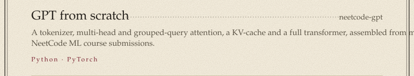
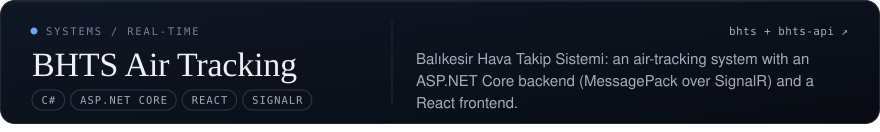
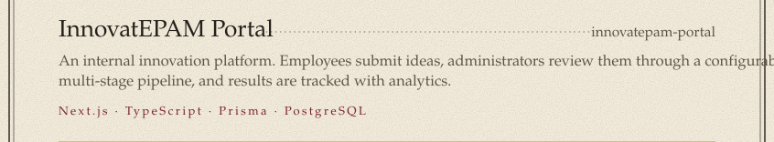
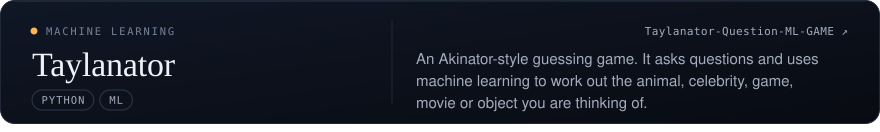
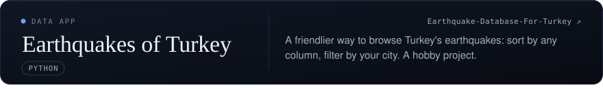
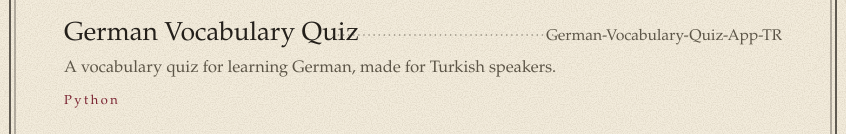
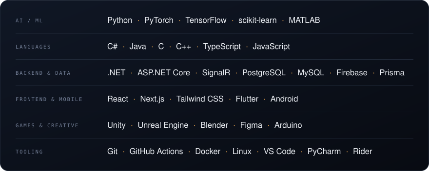

  <a href="https://www.aykanugur.com">Website</a> &nbsp;·&nbsp;
  <a href="https://linkedin.com/in/aykanugur/">LinkedIn</a> &nbsp;·&nbsp;
  <a href="mailto:aykanugur157@gmail.com">Email</a> &nbsp;·&nbsp;
  <a href="https://github.com/aykanugur?tab=repositories">All repositories</a>

Merhaba. I'm a developer in İzmir who builds language models, and I help teach the next batch of students as an undergraduate assistant.

## Selected work

More from the lab

 

- [bhts-api](https://github.com/aykanugur/bhts-api): the ASP.NET Core backend behind BHTS
- [AlliedAgent](https://github.com/aykanugur/AlliedAgent): SE320 game project
- [House_Prices_ML](https://github.com/aykanugur/House_Prices_ML), [Titanic_Survive_ML](https://github.com/aykanugur/Titanic_Survive_ML), [Spaceship-Titanic](https://github.com/aykanugur/Spaceship-Titanic): classic ML practice
- [neetcode-submissions](https://github.com/aykanugur/neetcode-submissions): my NeetCode.io solutions in C#
- [OfficeSim](https://github.com/aykanugur/OfficeSim), [SE115-BlueJack](https://github.com/aykanugur/SE115-BlueJack): Java projects
- [awesome-turkish-language-models](https://github.com/aykanugur/awesome-turkish-language-models), [turkish-nlp-resources](https://github.com/aykanugur/turkish-nlp-resources): Turkish NLP bookmarks
- [llm-from-scratch](https://github.com/aykanugur/llm-from-scratch): following along with *Build Your Own LLM from Scratch*

## Stack

## Activity

<picture>
  <source media="(prefers-color-scheme: dark)" srcset="https://raw.githubusercontent.com/aykanugur/aykanugur/output/github-snake-dark.svg">
  <source media="(prefers-color-scheme: light)" srcset="https://raw.githubusercontent.com/aykanugur/aykanugur/output/github-snake.svg">
  
</picture>

## Contact

  <a href="mailto:aykanugur157@gmail.com"><b>Email</b></a> &nbsp;·&nbsp;
  <a href="https://www.aykanugur.com"><b>Website</b></a> &nbsp;·&nbsp;
  <a href="https://linkedin.com/in/aykanugur/"><b>LinkedIn</b></a>

Set in Instrument Serif, Instrument Sans and JetBrains Mono (SIL OFL). Panels are generated: see <a href="scripts">scripts</a>.

