

  
  <a href="https://linkedin.com/in/aykanugur/">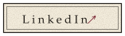</a>
  <a href="mailto:aykanugur157@gmail.com">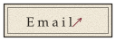</a>
  

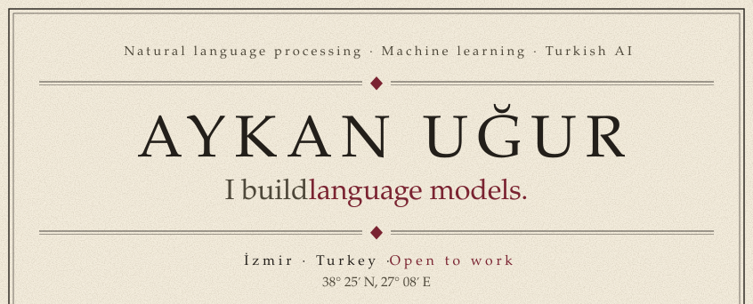 
 
<a href="https://github.com/aykanugur/neetcode-gpt">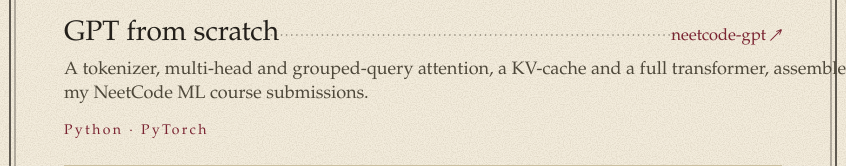</a> 
<a href="https://github.com/aykanugur/bhts">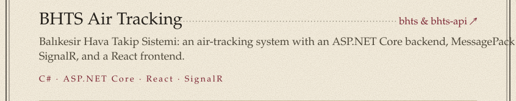</a> 
<a href="https://github.com/aykanugur/innovatepam-portal">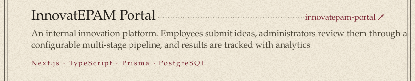</a> 
<a href="https://github.com/aykanugur/Taylanator-Question-ML-GAME">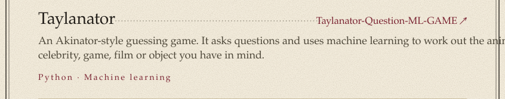</a> 
<a href="https://github.com/aykanugur/Earthquake-Database-For-Turkey">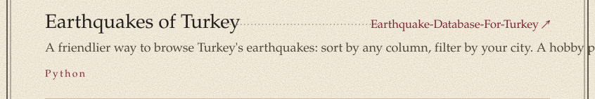</a> 
<a href="https://github.com/aykanugur/German-Vocabulary-Quiz-App-TR">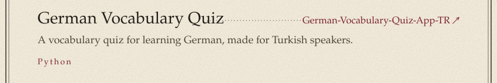</a> 
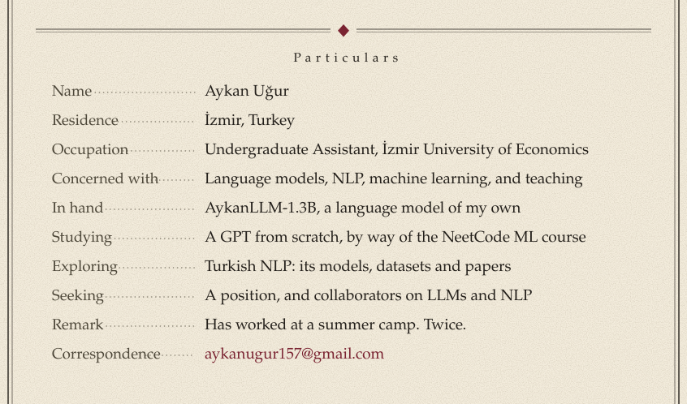 
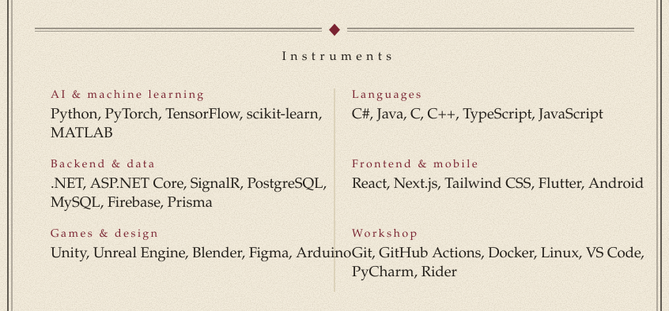 
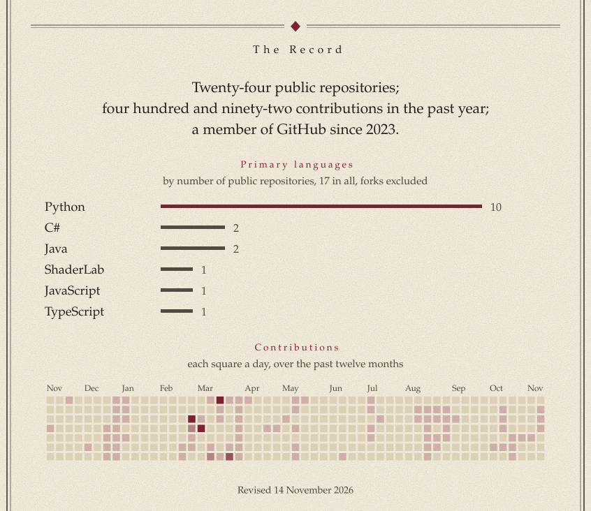 
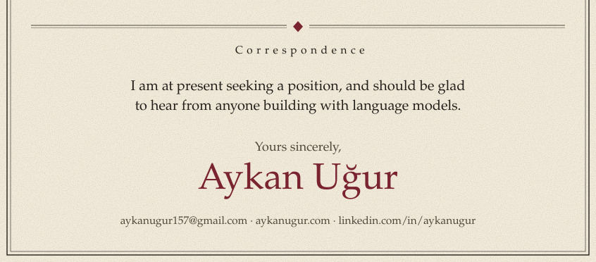

Other repositories

 

- [bhts-api](https://github.com/aykanugur/bhts-api): the ASP.NET Core backend behind BHTS
- [AlliedAgent](https://github.com/aykanugur/AlliedAgent): SE320 game project
- [House_Prices_ML](https://github.com/aykanugur/House_Prices_ML), [Titanic_Survive_ML](https://github.com/aykanugur/Titanic_Survive_ML), [Spaceship-Titanic](https://github.com/aykanugur/Spaceship-Titanic): classic ML practice
- [neetcode-submissions](https://github.com/aykanugur/neetcode-submissions): my NeetCode.io solutions in C#
- [OfficeSim](https://github.com/aykanugur/OfficeSim), [SE115-BlueJack](https://github.com/aykanugur/SE115-BlueJack): Java projects
- [awesome-turkish-language-models](https://github.com/aykanugur/awesome-turkish-language-models), [turkish-nlp-resources](https://github.com/aykanugur/turkish-nlp-resources): Turkish NLP bookmarks
- [llm-from-scratch](https://github.com/aykanugur/llm-from-scratch): following along with *Build Your Own LLM from Scratch*

Typeset in EB Garamond (SIL OFL). The pages are generated: see <a href="scripts">scripts</a>.

